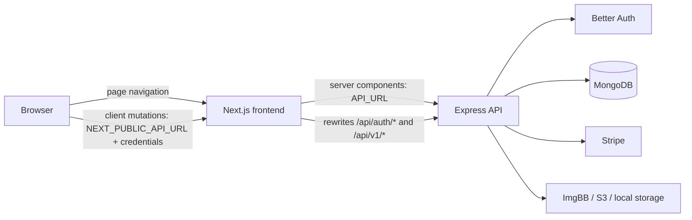
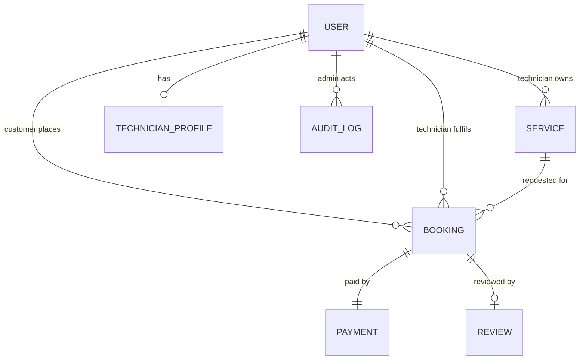
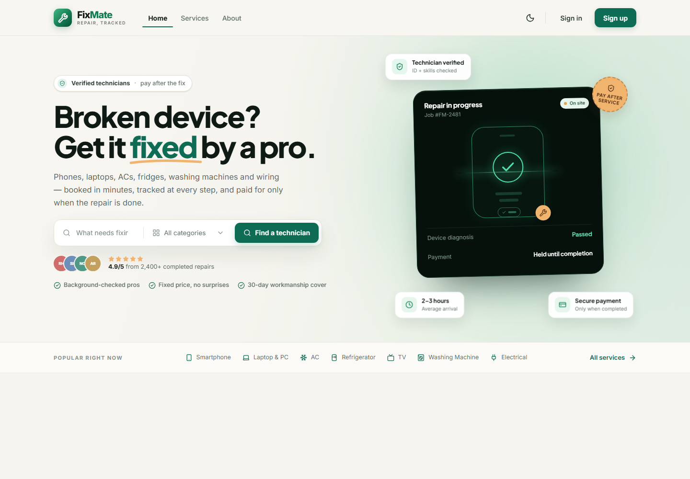
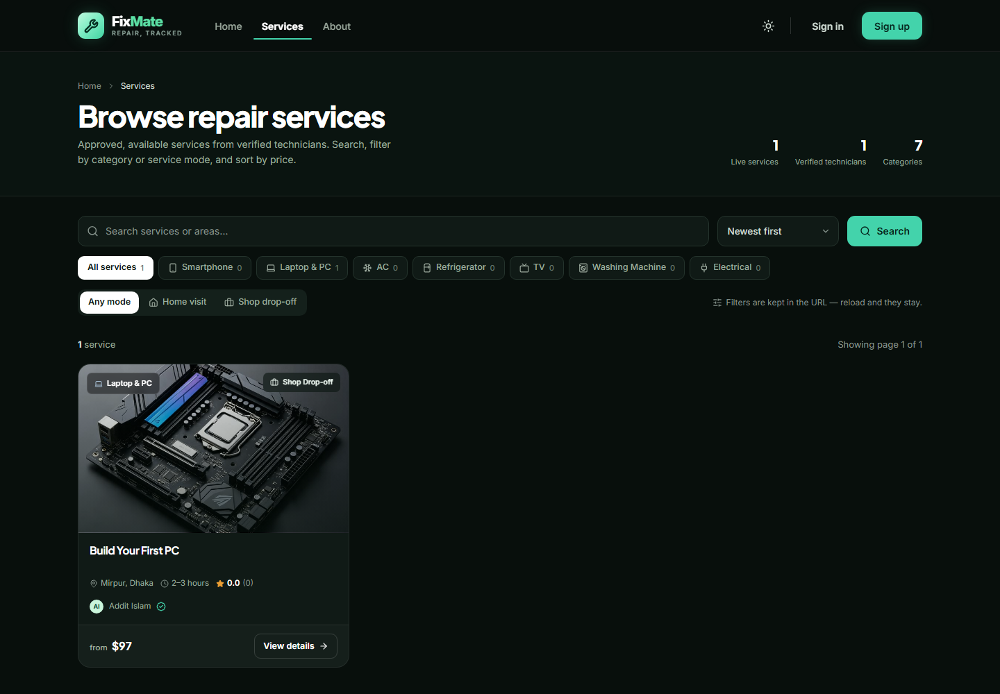
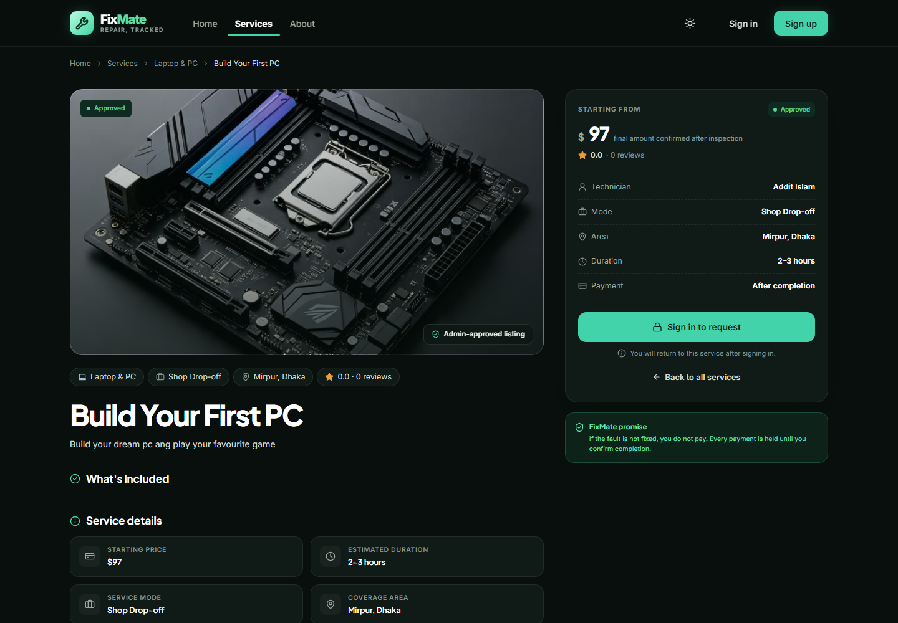
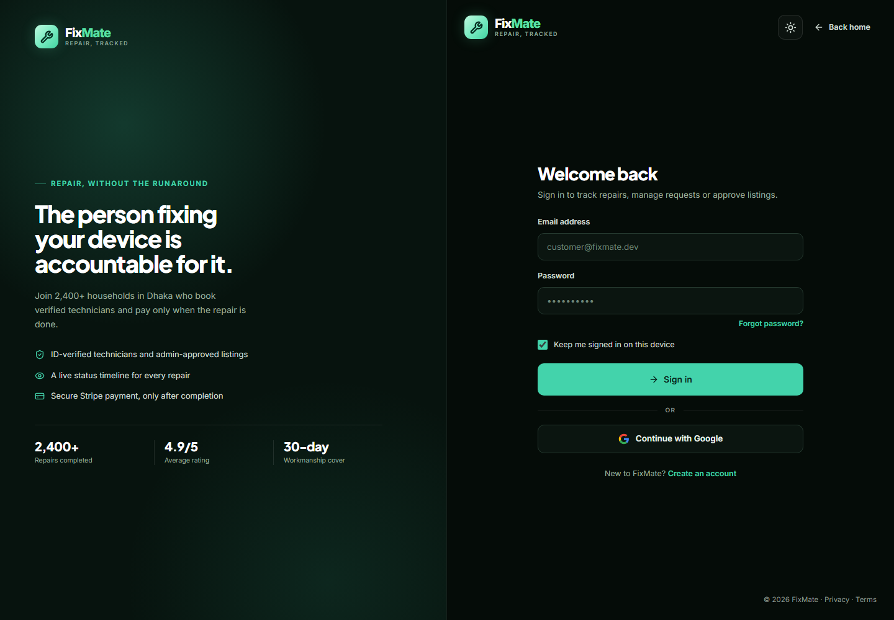

# FixMate — Repair, Tracked

**A full-stack, role-based marketplace for device and home-appliance repairs.**

FixMate connects customers with verified repair technicians for smartphones, laptops, ACs, refrigerators, TVs, washing machines, and electrical work. Customers browse approved services, request a repair, track every status change, and pay only after the job is complete. Technicians manage listings and requests, while admins moderate the marketplace, users, bookings, and payments.

[](https://nextjs.org/)
[](https://react.dev/)
[](https://www.typescriptlang.org/)
[](https://tailwindcss.com/)
[](https://expressjs.com/)
[](https://www.mongodb.com/atlas)
[](https://stripe.com/)

> **Status:** Core marketplace flows are implemented and the frontend is deployed. The public catalog, authentication, and API health are live. Stripe payments, uploads, and authenticated dashboards require the corresponding backend environment and accounts to be configured. Automated end-to-end tests and CI are not configured yet.

## Live Demo & Source

| Resource | URL |
|---|---|
| **Live application** | https://assignment-09-frontend-two.vercel.app |
| **Live API health** (through the frontend proxy) | https://assignment-09-frontend-two.vercel.app/api/v1/health |
| **Frontend repository** | https://github.com/rehat2007/Assignment-09-frontend- |
| **Backend repository** | https://github.com/rehat2007/Assignment-09-backend |

The backend is a separate Express service. Its direct origin is configured through the `API_URL` environment variable; browser traffic uses the frontend origin and is proxied to the backend by Next.js rewrites.

---

## Table of Contents

1. [Project Introduction](#1-project-introduction)
2. [Features](#2-features)
3. [Technology Stack](#3-technology-stack)
4. [Project Architecture](#4-project-architecture)
5. [Installation & Setup](#5-installation--setup)
6. [Environment Variables](#6-environment-variables)
7. [API Documentation](#7-api-documentation)
8. [Authentication & Authorization](#8-authentication--authorization)
9. [Database Design](#9-database-design)
10. [Screenshots / Demo](#10-screenshots--demo)
11. [Deployment](#11-deployment)
12. [Future Improvements](#12-future-improvements)
13. [Author & Contribution](#13-author--contribution)

---

## 1. Project Introduction

### What is the name of the project?

**FixMate** — tagline: *Repair, Tracked.*

### What is this project about?

FixMate is a full-stack repair marketplace with three user roles:

| Role | What they do |
|---|---|
| **Customer** | Discover approved services, request a repair, track the job, pay after completion, and review the technician. |
| **Technician** | Create and manage service listings, upload cover images, accept or reject requests, start work, complete jobs, and set the final amount. |
| **Admin** | Approve or reject listings, manage users and roles, suspend or restore accounts, monitor bookings, and review platform payments. |

The application is split into two deployments:

- **Frontend:** Next.js 16 App Router application in this repository.
- **Backend:** Express 5 + TypeScript API with MongoDB, Better Auth, JWT, Stripe, and pluggable image storage in the sibling `fix_mate_back_end` repository.

### What problem does it solve?

Hiring a repair technician is often opaque. Customers may not know who is coming, what the final price will be, whether the technician is qualified, or when they should pay. Technicians, meanwhile, lack a structured way to list services and manage incoming jobs.

FixMate makes the transaction accountable:

- Every public listing is **admin-approved**.
- Every job follows a **server-enforced status pipeline**.
- Every status change is visible on a **job timeline**.
- Payment is **unlocked only after the technician marks the job complete**.
- Reviews are allowed only after a **completed and paid** booking.
- Admins get a platform-wide view of users, listings, bookings, and revenue.

### Why was this project built?

FixMate was built as the **Assignment 9 full-stack submission** and as a realistic portfolio project. The goal was to implement the complete repair lifecycle — discovery, approval, booking, fulfilment, payment, and review — with real authentication, role-based access control, server-side validation, and payment verification rather than a UI-only prototype.

### Who are the intended users?

- **Customers** who need a phone, laptop, appliance, or electrical repair and want price transparency and a tracked job.
- **Independent technicians** who want a professional listing and a simple way to manage requests.
- **Platform administrators** who need to moderate listings, users, bookings, and payments.
- **Developers and evaluators** reviewing a production-style full-stack implementation.

The UI copy and seed data use a Dhaka, Bangladesh context, but the architecture is location-agnostic.

### What makes this project useful or different?

- **Pay-after-service:** Stripe Checkout opens only after the technician completes the job and sets a positive final amount.
- **Admin-gated catalog:** Only approved, available, non-deleted listings appear publicly.
- **Server-enforced state machine:** Booking transitions are validated by the API, not by the browser.
- **Dual authentication:** Better Auth session cookies for the web app, plus a JWT cookie for API clients and server-to-server requests.
- **Idempotent payments:** One payment per booking, with unique Stripe session and payment-intent IDs.
- **Role-specific dashboards:** Customer, technician, and admin experiences are separated by both UI and backend middleware.
- **Transparent reviews:** One review per paid booking, with rating aggregation and a 5★→1★ distribution on the service page.

---

## 2. Features

### Main features

| Area | Features |
|---|---|
| **Public catalog** | Approved-service listing, keyword search, category and mode filters, price/newest/rating sorting, URL-driven filters, pagination, service detail pages, review distribution. |
| **Authentication** | Email/password sign-up and sign-in, optional Google OAuth, session cookies, JWT fallback cookie, sign-out, password visibility toggle, network-error handling. |
| **Customer dashboard** | Overview stats, active repair, booking list, status timeline, cancel request, Stripe payment, payment history, review dialog, profile editing, avatar upload. |
| **Technician dashboard** | Overview metrics, listing CRUD, cover upload, availability toggle, soft delete, request list, accept/reject/start/complete actions, final amount entry. |
| **Admin dashboard** | Platform overview, pending-listing queue, approve/reject, user list, role changes, suspend/restore, booking list, payment/revenue view, client-side CSV export. |
| **Payments** | Stripe Checkout, success-page verification, signed webhook, idempotent payment recording, invoice/transaction data. |
| **Reviews** | One review per completed+paid booking, rating aggregation, public review list, rating distribution. |
| **Media** | Avatar uploads (2 MB), service-cover uploads (5 MB), byte-level MIME detection, local/ImgBB/S3 drivers. |
| **Platform** | Responsive layout, dark/light theme, GSAP motion with reduced-motion support, toast notifications, loading skeletons, custom error/404 pages. |

### What can users do with this application?

**As a customer**

- Create an account or sign in.
- Search, filter, and sort approved services.
- Open a service detail page and submit a repair request with a preferred date, phone, address, and problem description.
- Track the job through `requested → accepted → in-progress → completed`.
- Cancel a request while it is still `requested`.
- Pay a completed, unpaid job through Stripe.
- View payment history and transaction IDs.
- Leave one review after the booking is completed and paid.
- Update name, phone, area, bio, and avatar.

**As a technician**

- Create a listing; new listings start as `pending`.
- Edit a listing; editing an approved or rejected listing sends it back to `pending`.
- Toggle availability.
- Soft-delete a listing.
- Accept, reject, start, and complete assigned jobs.
- Set the final amount when completing a job.
- View earnings, paid jobs, and the request pipeline.
- Upload a service cover image.

**As an admin**

- Approve or reject any non-deleted listing.
- Clear the rejection reason on approval; store it on rejection.
- Change a user's role between customer, technician, and admin.
- Suspend and restore users through Better Auth bans.
- View all bookings with status and payment filters.
- View all payments and revenue summaries.
- Export loaded admin data to CSV from the browser.

### Does it have authentication?

Yes. Better Auth provides email/password authentication and optional Google OAuth. The Express API additionally issues a JWT stored in an httpOnly `fixmate_token` cookie. See [Section 8](#8-authentication--authorization).

### Does it support CRUD operations?

Yes, across the domain:

- **Services:** create, read, update, availability toggle, soft delete.
- **Bookings:** create, read, cancel, status transitions, complete with final amount.
- **Reviews:** create and read.
- **Payments:** create via Stripe Checkout, read/verify.
- **Users:** read, role update, suspend/restore (no hard delete).
- **Profile:** update name, phone, area, bio, image.

### Does it have role-based access control?

Yes. Three application roles are resolved from Better Auth data:

1. `admin` — if the Better Auth admin-plugin `role` contains `admin`.
2. `technician` — if `accountType === "technician"`.
3. `customer` — otherwise.

The frontend uses server-component guards (`requireUser`, `requireRole`), and the backend independently enforces `verifyCustomer`, `verifyTechnician`, and `verifyAdmin`. An admin cannot call customer-only endpoints.

### Does it include any advanced functionality?

- **Stripe Checkout + webhook verification** with server-side amount validation and idempotent recording.
- **Dual auth model** (Better Auth session + JWT cookie) with an explicit Bearer-token path for API clients.
- **Server-enforced booking state machine** with ownership checks and atomic status transitions.
- **Next.js cache tags and ISR** for public catalog data, invalidated after listings/reviews change.
- **Byte-level image validation** and three upload drivers (local, ImgBB, S3-compatible).
- **Rate limiting** on auth, booking creation, and uploads.
- **Audit logging** for admin actions.
- **Rating aggregation** and review distribution computed from MongoDB.
- **Responsive, themed UI** with GSAP motion and reduced-motion support.

---

## 3. Technology Stack

### Frontend technologies

| Technology | Version | Role |
|---|---|---|
| **Next.js** | 16.4 | App Router, server components, routing, rewrites, ISR/cache tags |
| **React** | 19.3 | UI rendering and client interactivity |
| **TypeScript** | 5.x | Type-safe frontend code |
| **Tailwind CSS** | 4.3 | CSS-first styling, design tokens, dark mode |
| **Base UI** (`@base-ui/react`) | 1.9 | Accessible unstyled primitives behind the shadcn-style components |
| **shadcn-style components** | base-nova | Local UI primitives in `src/components/ui` |
| **Lucide React** | 1.75 | Icons |
| **Sonner** | 2.0 | Toast notifications |
| **GSAP + ScrollTrigger** | 3.15 | Homepage and section motion |
| **Better Auth client** | 1.7 | Browser auth client, session hook, admin client |
| **`cn`** | 0.5 | Conditional class composition (no `clsx`/`tailwind-merge`) |

### Backend technologies

| Technology | Version | Role |
|---|---|---|
| **Node.js** | 20.9+ | Runtime |
| **Express** | 5.3 | HTTP API and middleware pipeline |
| **TypeScript** | 5.9 | Type-safe backend code |
| **MongoDB** | 7.x driver | Primary datastore |
| **Better Auth** | 1.7 | Identity, sessions, password hashing, Google OAuth, admin plugin |
| **JWT** (`jsonwebtoken`) | 9.x | API access tokens |
| **Zod** | 4.x | Request validation and environment validation |
| **Stripe** | 23.x | Checkout Sessions and webhooks |
| **Multer** | 2.x | Multipart upload handling |
| **AWS S3 SDK** | 3.x | S3/R2/MinIO storage driver |
| **Helmet** | 8.x | Security headers |
| **CORS** | 2.x | Trusted-origin policy |
| **express-rate-limit** | 8.x | Auth/booking/upload throttling |

### Database

**MongoDB** (MongoDB Atlas or local MongoDB) with the native MongoDB Node.js driver and the Better Auth MongoDB adapter. The database is `fixmate` by default.

### Authentication system

**Better Auth** for identity and sessions, plus a **JWT** issued by the Express API and stored in an httpOnly cookie. The API accepts either a Better Auth session or a valid JWT (Bearer header or cookie). See [Section 8](#8-authentication--authorization).

### Third-party libraries and APIs

- **Stripe Checkout** and **Stripe webhooks**.
- **Google OAuth** (optional).
- **ImgBB**, **AWS S3**, **Cloudflare R2**, or **MinIO** for image storage.
- **MongoDB Atlas** for hosted MongoDB.
- **Vercel** for frontend and backend deployment.

### Why were these technologies chosen?

| Choice | Rationale |
|---|---|
| **Next.js App Router** | Server-rendered public pages, SEO-friendly service detail pages, server components for authenticated dashboards, and built-in rewrites for same-origin API/auth cookies. |
| **React 19 + TypeScript** | A modern component model with end-to-end type safety for DTOs, API responses, and forms. |
| **Tailwind CSS v4** | Fast, consistent styling without a separate Tailwind config; tokens and dark mode live in CSS. |
| **Base UI / shadcn-style components** | Accessible primitives that can be owned locally instead of pulling in a heavy component framework. |
| **Express 5** | Explicit middleware order, straightforward route organization, and easy deployment as a Node service or Vercel function. |
| **MongoDB** | Flexible documents for services, bookings, and payments, with indexes for catalog and dashboard queries. |
| **Better Auth** | Mature email/password and OAuth support, session management, and an admin plugin for roles/bans. |
| **JWT fallback** | Gives API clients a portable Bearer token while keeping browser auth cookie-based. |
| **Zod** | One validation layer for request bodies, query strings, params, and environment variables. |
| **Stripe Checkout** | Hosted payment UI reduces PCI scope; webhooks provide server-side confirmation. |
| **ImgBB / S3 drivers** | Works for a free demo deployment and can scale to object storage without changing application code. |
| **Vercel** | Simple Git-based deployments for both the Next.js frontend and the Express serverless backend. |

---

## 4. Project Architecture

### How is the project structured?

FixMate is intentionally split into two repositories:

```text
fix_mate/
├── fix_mate_front_end/          # Next.js 16 application (this repo)
│   ├── src/app/                 # Routes, layouts, server actions
│   ├── src/components/          # Public, dashboard, auth, and UI components
│   ├── src/lib/                 # API clients, auth helpers, DTOs, preview data
│   ├── docs/screenshots/        # README screenshots
│   ├── next.config.ts           # API/auth rewrites + redirects
│   └── AGENTS.md                # Repository guidance for coding agents
└── fix_mate_back_end/           # Express 5 API + MongoDB
    ├── src/
    │   ├── index.ts             # App, middleware order, route mounts
    │   ├── auth.ts              # Better Auth configuration
    │   ├── routes/              # HTTP route definitions
    │   ├── services/            # Business logic
    │   ├── middleware/          # Auth, validation, errors, rate limits
    │   ├── validation/          # Zod schemas
    │   ├── db/                  # Mongo client, collections, indexes
    │   └── types/               # Document and DTO types
    └── scripts/                 # Seed, migration, admin, smoke test
```

### Frontend route map

| Route | Purpose |
|---|---|
| `/` | Marketing homepage, featured services, categories, trust content |
| `/services` | Public catalog with URL-driven filters, sorting, and pagination |
| `/services/[id]` | Service detail, reviews, booking request |
| `/about` | Product story and repair pipeline |
| `/sign-in`, `/sign-up` | Authentication |
| `/dashboard` | Redirects to the current role's workspace |
| `/dashboard/customer/*` | Customer overview, bookings, payments |
| `/dashboard/technician/*` | Technician overview, listings, requests, add service |
| `/dashboard/admin/*` | Admin overview, users, services, bookings, transactions |
| `/dashboard/profile` | Profile and avatar editing |
| `/payment/success` | Server-verified Stripe return page |
| `/payment/cancel` | Stripe cancellation page |
| `/how-it-works` | Permanent redirect to `/about` |

### How does the frontend communicate with the backend?

There are two distinct paths:



1. **Server components** call `apiFetch()` in `src/lib/api.ts` using the server-only `API_URL`. The helper unwraps `{ data, meta }`, throws `ApiRequestError` on failure, applies `revalidate: 60` by default, and forwards the browser cookie only when `withCookies: true`.
2. **Client components** call `${NEXT_PUBLIC_API_URL}/api/v1/...` directly with `credentials: "include"`. They handle their own JSON and error states.
3. **Browser auth** uses Better Auth from `src/lib/auth-client.ts` with `credentials: "include"`.
4. **Next.js rewrites** in `next.config.ts` proxy `/api/auth/*` and `/api/v1/*` to `API_URL`. In production, `NEXT_PUBLIC_API_URL` is the **frontend origin**, so auth cookies live on the frontend host and server components can read them.

> **Critical deployment detail:** Do not point `NEXT_PUBLIC_API_URL` at the backend origin in production. Doing so makes sign-in appear to succeed while the dashboard redirects back to `/sign-in`, because the session cookie is stored on the wrong host.

### How does the application handle data?

- **Public catalog** data is fetched by server components from `/api/v1/meta`, `/api/v1/services`, and `/api/v1/services/:slug`.
- Catalog responses are tagged `catalog`; after a listing, review, or admin approval change, the client calls the server action `revalidateCatalog()` (`updateTag("catalog")`).
- **Authenticated dashboards** use server fetchers in `src/lib/customer-api.ts`, `src/lib/technician-api.ts`, and `src/lib/admin-api.ts`, forwarding cookies with `withCookies: true`.
- **Mutations** happen in client components and then refresh the route with `router.refresh()`.
- **Pagination** is server-side; public pages default to 9 items, dashboards to 20, maximum 100.
- **Preview data** in `src/lib/*-data.ts` still powers a few presentation-only areas (profile statistics and listing plan/rating copy), while dashboard sidebar counts and all real catalog/booking/payment data are live.

### How does authentication work?

```text
Sign in / sign up
      │
      ▼
Better Auth session cookie  ──►  Next.js server components read /api/auth/get-session
      │
      ▼
TokenBootstrap POSTs /api/v1/auth/token
      │
      ▼
Express sets httpOnly `fixmate_token` JWT cookie
      │
      ▼
API accepts Better Auth session OR JWT cookie OR Bearer token
```

- Better Auth runs on Express under `/api/auth/*`.
- `src/lib/authz.ts` reads the session with the forwarded cookie and wraps it in React `cache`.
- `requireUser` redirects to `/sign-in`; `requireRole` redirects to `/dashboard`.
- Sign-out clears the JWT cookie through `/api/v1/auth/logout`, then calls `authClient.signOut`.
- See [Section 8](#8-authentication--authorization) for roles, routes, and permissions.

### How are API requests and responses handled?

All API routes use one envelope:

**Success**

```json
{
  "data": {},
  "meta": {}
}
```

**Error**

```json
{
  "error": {
    "code": "VALIDATION_ERROR",
    "message": "Request validation failed.",
    "details": []
  }
}
```

- The frontend unwraps successful envelopes in `apiFetch()`.
- Errors become `ApiRequestError` with `status` and `code`.
- Paginated responses include `meta.page`, `meta.pageSize`, `meta.total`, and `meta.totalPages`.
- The API returns an `X-Request-Id` header for request tracing.
- See [Section 7](#7-api-documentation) for endpoints, parameters, and error codes.

### How does the application manage errors?

**Backend**

- Expected failures throw `ApiError`, which the central error handler converts to the standard error envelope.
- Zod errors return `422 VALIDATION_ERROR` with field-level details.
- Malformed JSON returns `400 MALFORMED_JSON`; oversized bodies return `413 PAYLOAD_TOO_LARGE`.
- Unknown errors return `500 INTERNAL_ERROR` without leaking stack traces in production.
- Request IDs are logged and exposed via `X-Request-Id`.

**Frontend**

- Server pages use `error.tsx`, `not-found.tsx`, and dashboard-specific error boundaries.
- Client mutations catch non-2xx responses, parse the error envelope, and show a Sonner toast.
- Auth forms normalize network failures with `getAuthErrorMessage()`.
- The payment success page distinguishes “verified” from “could not verify” and renders an alert state.

---

## 5. Installation & Setup

### Prerequisites

- **Node.js 20.9+** (Node 24 was used during development).
- **npm** (the repository uses `package-lock.json`).
- **MongoDB** — local MongoDB or a MongoDB Atlas cluster.
- **Stripe test keys** — optional, needed for payment testing.
- **ImgBB API key, S3/R2/MinIO credentials, or local storage** — for uploads.
- **Google OAuth credentials** — optional.

### Clone the repositories

```powershell
cd C:\web_dev\fix_mate
git clone https://github.com/rehat2007/Assignment-09-backend.git fix_mate_back_end
git clone https://github.com/rehat2007/Assignment-09-frontend-.git fix_mate_front_end
```

### Install and configure the backend

```powershell
cd C:\web_dev\fix_mate\fix_mate_back_end
Copy-Item .env.example .env
# Edit .env with MongoDB, Better Auth, admin, Stripe, and upload values.
npm install
npm run migrate:schema
npm run auth:admin
npm run dev
```

Backend URLs:

```text
http://localhost:4000
http://localhost:4000/api/v1/health
```

`npm run auth:admin` creates or promotes the account identified by `ADMIN_EMAIL` and `ADMIN_PASSWORD`.

> `npm run seed` is for **local development only**. Never run it against a production database. Use `npm run data:clear-demo` to remove demo data from a local/demo database.

### Install and configure the frontend

```powershell
cd C:\web_dev\fix_mate\fix_mate_front_end
# Create .env (this app reads .env, not .env.local).
npm install
npm run dev
```

Frontend URL:

```text
http://localhost:3000
```

> The older assignment notes say `.env.local`; this application loads `.env`. There is currently no frontend `.env.example`, so create `.env` manually using the variables in [Section 6](#6-environment-variables).

### Optional: load local demo data

```powershell
cd C:\web_dev\fix_mate\fix_mate_back_end
npm run seed
```

The seed creates demo technicians and customers, services, bookings, and paid demo transactions. Re-running it is idempotent for existing accounts.

### Test payments locally

Use Stripe test mode and the test card:

```text
4242 4242 4242 4242
Any future expiry
Any 3-digit CVC
```

Forward webhooks to the local API:

```powershell
stripe listen --forward-to localhost:4000/api/v1/webhooks/stripe
```

Put the printed `whsec_...` value into `STRIPE_WEBHOOK_SECRET` and restart the backend.

### Test uploads locally

```env
UPLOAD_DRIVER=local
```

or, for ImgBB:

```env
UPLOAD_DRIVER=imgbb
IMGBB_API_KEY=your_imgbb_key
```

Avatar uploads are limited to 2 MB and service covers to 5 MB. Allowed types are JPG, PNG, and WebP; MIME is detected from the file bytes.

### Verify the build

```powershell
cd C:\web_dev\fix_mate\fix_mate_front_end
npx next typegen
npx tsc --noEmit
npm run lint
npm run build
```

> **Build prerequisite:** `npm run build` prerenders `/`, which calls `/api/v1/meta` and `/api/v1/services`. The Express API must be reachable at `API_URL`, or the build fails on `/` with `fetch failed`. For a backend-free check, run typegen, `tsc`, and lint instead.

### Useful backend commands

| Command | Purpose |
|---|---|
| `npm run dev` | Start the API with `tsx watch` on `PORT` (default 4000). |
| `npm run typecheck` | TypeScript check without emitting. |
| `npm run build` | Compile to `dist/`. |
| `npm start` | Run the compiled API. |
| `npm run migrate:schema` | Backfill Assignment 9 compatibility fields; run after schema changes and on deploy. |
| `npm run auth:admin` | Create or promote the configured admin account. |
| `npm run seed` | Local/demo data only. |
| `npm run data:clear-demo` | Remove local/demo data only. |
| `npm run test:smoke` | Local smoke test; requires a seeded database and running server. |

---

## 6. Environment Variables

### Frontend `.env`

| Variable | Required? | Purpose |
|---|---|---|
| `API_URL` | **Yes** | Backend origin used by server components and `src/lib/authz.ts`. Example: `http://localhost:4000`. |
| `NEXT_PUBLIC_API_URL` | **Yes** | Browser API/auth origin. Use `http://localhost:4000` locally. In production, use the **frontend origin** so Next.js rewrites proxy requests and cookies stay on the frontend host. |
| `GOOGLE_CLIENT_ID` | Optional | Only controls whether the Google sign-in/sign-up buttons render. OAuth itself runs on Express. |
| `GOOGLE_CLIENT_SECRET` | Optional | Same as above. |

Example local `.env`:

```env
API_URL=http://localhost:4000
NEXT_PUBLIC_API_URL=http://localhost:4000
GOOGLE_CLIENT_ID=
GOOGLE_CLIENT_SECRET=
```

Production example:

```env
API_URL=https://your-backend.vercel.app
NEXT_PUBLIC_API_URL=https://your-frontend.vercel.app
GOOGLE_CLIENT_ID=
GOOGLE_CLIENT_SECRET=
```

> `NEXT_PUBLIC_*` variables are embedded in the browser bundle. Never put secrets there.

### Backend `.env`

| Variable | Required? | Purpose |
|---|---|---|
| `NODE_ENV` | Optional | `development`, `test`, or `production`; defaults to `development`. |
| `PORT` | Optional | API port; defaults to `4000`. |
| `MONGODB_URI` | **Yes** | MongoDB connection string (Atlas or local). |
| `MONGODB_DB` | **Yes** | Database name; usually `fixmate`. |
| `MONGODB_DNS_SERVERS` | Optional | Custom DNS resolver for `mongodb+srv://` on networks that block SRV lookups (e.g. `1.1.1.1`). |
| `BETTER_AUTH_SECRET` | **Yes** | Signing secret, **at least 32 characters**; startup fails otherwise. |
| `BETTER_AUTH_URL` | **Yes** | Backend origin used for cookies, OAuth callbacks, and local upload URLs. |
| `FRONTEND_URL` | **Yes** | Exact frontend origin allowed by CORS and Better Auth `trustedOrigins`. |
| `JWT_SECRET` | Recommended | Separate JWT signing secret; falls back to `BETTER_AUTH_SECRET`. |
| `JWT_EXPIRES_IN` | Optional | JWT lifetime; defaults to `7d`. |
| `ADMIN_EMAIL` | **Yes** | Email for the admin account created by `npm run auth:admin`. |
| `ADMIN_NAME` | Optional | Display name for the admin account. |
| `ADMIN_PASSWORD` | **Yes for admin setup** | Password used by `npm run auth:admin`; must be at least 8 characters. Never commit it. |
| `SEED_PASSWORD` | Local demo only | Password for seeded non-admin demo accounts; defaults to `FixMateDemo123!`. |
| `GOOGLE_CLIENT_ID` | Optional | Google OAuth client ID. |
| `GOOGLE_CLIENT_SECRET` | Optional | Google OAuth client secret. |
| `STRIPE_SECRET_KEY` | For payments | Stripe test/live secret key. Leave blank to run without checkout. |
| `STRIPE_WEBHOOK_SECRET` | For webhooks | Stripe signing secret (`whsec_...`). |
| `UPLOAD_DRIVER` | **Yes** | `local`, `imgbb`, or `s3`; defaults to `local`. |
| `IMGBB_API_KEY` | If `UPLOAD_DRIVER=imgbb` | Required by the ImgBB driver. |
| `S3_BUCKET` | If `UPLOAD_DRIVER=s3` | Bucket name. |
| `S3_REGION` | If `UPLOAD_DRIVER=s3` | Region; R2 uses `auto`. |
| `S3_ACCESS_KEY_ID` | If `UPLOAD_DRIVER=s3` | Access key; omit both key fields to use the default AWS credential chain. |
| `S3_SECRET_ACCESS_KEY` | If `UPLOAD_DRIVER=s3` | Secret key. |
| `S3_ENDPOINT` | Optional | Custom endpoint for R2/MinIO. |
| `S3_PUBLIC_URL` | Optional | Public/CDN base URL for stored objects. |
| `S3_FORCE_PATH_STYLE` | Optional | `true` for MinIO/path-style providers. |

### Where to obtain API keys

| Service | Where |
|---|---|
| **MongoDB Atlas** | https://www.mongodb.com/atlas |
| **Stripe test keys** | https://dashboard.stripe.com/test/apikeys |
| **Stripe webhook secret** | `stripe listen` output, or the Stripe Dashboard webhook settings |
| **Google OAuth** | https://console.cloud.google.com/apis/credentials |
| **ImgBB** | https://api.imgbb.com/ |
| **AWS S3 / R2 / MinIO** | Your provider's console; use the `S3_*` variables |

Generate a strong Better Auth secret with:

```powershell
node -e "console.log(require('crypto').randomBytes(32).toString('hex'))"
```

### Security considerations

- **Keep backend secrets server-side.** Only `NEXT_PUBLIC_API_URL` and the optional public Google client ID belong in browser-visible variables.
- **Use a strong, unique `BETTER_AUTH_SECRET`** (32+ characters) and a separate `JWT_SECRET`.
- **Never commit `.env` files.** The repository ignores `.env*`; only `.env.example` belongs in the backend repository.
- **Use production origins exactly.** `BETTER_AUTH_URL` must be the backend origin; `FRONTEND_URL` must be the frontend origin; CORS and Better Auth trusted origins depend on both.
- **Cookies are httpOnly and secure in deployed environments** (`SameSite=None` when deployed, `Lax` locally).
- **Stripe webhooks require the raw request body** and a valid signature. The server verifies the signature and the amount before recording a payment.
- **Never trust client amounts, roles, or status values.** The backend recomputes roles, loads booking amounts, and enforces status transitions.
- **Do not run demo seed scripts against production.** Use `npm run auth:admin` and real sign-ups instead.
- **Rotate any key that was ever committed or shared.** Use test-mode Stripe keys for demos.

---

## 7. API Documentation

### Base URLs

| Environment | Base URL |
|---|---|
| Local API | `http://localhost:4000/api/v1` |
| Live public API (through the frontend proxy) | `https://assignment-09-frontend-two.vercel.app/api/v1` |
| Better Auth (local) | `http://localhost:4000/api/auth` |
| Better Auth (live, through proxy) | `https://assignment-09-frontend-two.vercel.app/api/auth` |

All endpoint paths below are relative to `/api/v1` unless they start with `/api/auth` (Better Auth) or are shown with a full path. Requests and responses are JSON unless the endpoint is an upload or webhook.

### Authentication for API requests

Protected endpoints accept any of:

1. A valid **Better Auth session cookie** (browser/server-rendered requests).
2. The **`fixmate_token` JWT cookie** set by `POST /api/v1/auth/token`.
3. An explicit **`Authorization: Bearer <token>`** header. Explicit Bearer tokens take precedence for API clients.

### Response envelope

**Success**

```json
{
  "data": {},
  "meta": {}
}
```

**Paginated success**

```json
{
  "data": [],
  "meta": {
    "page": 1,
    "pageSize": 20,
    "total": 42,
    "totalPages": 3
  }
}
```

**Error**

```json
{
  "error": {
    "code": "FORBIDDEN",
    "message": "You do not have access.",
    "details": []
  }
}
```

### Public endpoints

| Method | Endpoint | Access | Parameters | Returns |
|---|---|---|---|---|
| `GET` | `/health` | Public | — | `{ ok, service, database, timestamp }`; `503` if MongoDB is unreachable. |
| `GET` | `/meta` | Public | — | Categories, modes, page sizes, service/technician counts, feature flags. |
| `GET` | `/services` | Public | `q`, `category`, `mode`, `sort` (`newest`/`price-asc`/`price-desc`/`rating`), `page`, `pageSize` | Paginated service summaries. |
| `GET` | `/services/:slug` | Public | `slug` in the path | Service detail with includes, warranty, availability note, and technician profile. |
| `GET` | `/services/:slug/reviews` | Public | `slug`, `page`, `pageSize` | Paginated reviews plus `meta.distribution` (5★→1★ percentages). |

`GET /services` filters:

- `q`: 1–100 characters; searched across title, description, technician, category, and location.
- `category`: one of `Smartphone`, `Laptop & PC`, `AC`, `Refrigerator`, `TV`, `Washing Machine`, `Electrical`.
- `mode`: `Home Visit` or `Shop Drop-off`.
- `page`: integer ≥ 1 (default 1).
- `pageSize`: integer 1–100 (default 9 for public catalog endpoints).

Only listings with `approval: "approved"`, `available: true`, and `deletedAt: null` are public.

### Authentication endpoints

| Method | Endpoint | Access | Body / parameters | Returns |
|---|---|---|---|---|
| `POST` | `/api/auth/sign-up/email` | Public | `{ name, email, password, accountType?, phone?, area?, bio? }` | Better Auth session and user. `accountType` is sanitized to `customer` or `technician`. |
| `POST` | `/api/auth/sign-in/email` | Public | `{ email, password, rememberMe? }` | Better Auth session and user. |
| `POST` | `/api/auth/sign-in/social` | Public | `{ provider: "google", callbackURL }` | OAuth redirect URL. |
| `POST` | `/api/auth/sign-out` | Authenticated session | — | Sign-out response; clears the Better Auth session. |
| `POST` | `/auth/token` | Authenticated session | — | `{ token, tokenType: "Bearer", expiresIn }`; also sets the `fixmate_token` cookie. |
| `POST` | `/auth/logout` | Public | — | `{ ok: true }`; clears the JWT cookie. |
| `GET` | `/me` | Any signed-in user | — | `{ user, role, session: { expiresAt } }`; read-only. |

Profile writes use Better Auth `POST /api/auth/update-user` with `name`, `phone`, `area`, `bio`, and `image`.

### Customer endpoints

| Method | Endpoint | Access | Parameters / body | Returns |
|---|---|---|---|---|
| `POST` | `/bookings` | Customer | `{ serviceSlug, preferredDate, phone, address, problem }` | Created booking (`201`). |
| `GET` | `/bookings` | Customer | `status?`, `page`, `pageSize` | Paginated own bookings. |
| `GET` | `/bookings/:id` | Customer (owner) | `id` in the path | Booking detail with `statusHistory`. |
| `POST` | `/bookings/:id/cancel` | Customer (owner) | `id` | Updated booking; only `requested` bookings can be cancelled. |
| `POST` | `/bookings/:id/review` | Customer (owner) | `{ rating: 1–5, text: 1–1000 }` | Created review (`201`); booking must be `completed` + `paid`. |
| `POST` | `/bookings/:id/checkout` | Customer (owner) | `id` | `{ url }` Stripe Checkout URL; booking must be `completed` with a positive `finalAmount`. |
| `GET` | `/customer/overview` | Customer | — | Stats, counts, active booking, recent bookings, spend series. |
| `GET` | `/customer/payments` | Customer | `page`, `pageSize` | Paginated payment history. |
| `GET` | `/payments/:id` | Customer (owner) or admin | `id` | Payment detail. |
| `GET` | `/payments/verify` | Customer | `session_id` query | Verified payment record from Stripe Checkout. |

Example booking body:

```json
{
  "serviceSlug": "build-your-first-pc",
  "preferredDate": "2026-12-01",
  "phone": "01712345678",
  "address": "House 27, Road 9, Dhanmondi, Dhaka",
  "problem": "The PC powers on but does not display anything on the monitor."
}
```

### Technician endpoints

| Method | Endpoint | Access | Parameters / body | Returns |
|---|---|---|---|---|
| `GET` | `/technician/overview` | Technician | — | Stats, earnings, paid jobs, request pipeline. |
| `GET` | `/technician/services` | Technician | `approval?`, `available?`, `page`, `pageSize` | Own listings. |
| `POST` | `/technician/services` | Technician | Service body (below) | Created listing (`201`), initially `pending`. |
| `GET` | `/technician/services/:id` | Technician (owner) | `id` | Own listing detail. |
| `PATCH` | `/technician/services/:id` | Technician (owner) | Partial service body; at least one field | Updated listing; approved/rejected listings return to `pending`. |
| `PATCH` | `/technician/services/:id/availability` | Technician (owner) | `{ available: boolean }` | Updated listing. |
| `DELETE` | `/technician/services/:id` | Technician (owner) | `id` | `204 No Content`; soft delete. |
| `GET` | `/technician/requests` | Technician | `status?`, `page`, `pageSize` | Assigned jobs. |
| `GET` | `/technician/requests/:id` | Technician (owner) | `id` | Job detail. |
| `POST` | `/technician/requests/:id/accept` | Technician (owner) | `id` | Updated booking (`accepted`). |
| `POST` | `/technician/requests/:id/reject` | Technician (owner) | `{ reason? }` | Updated booking (`rejected`). |
| `POST` | `/technician/requests/:id/start` | Technician (owner) | `id` | Updated booking (`in-progress`). |
| `POST` | `/technician/requests/:id/complete` | Technician (owner) | `{ finalAmount: positive integer ≤ 100000 }` | Updated booking (`completed`). |

Service create body:

```json
{
  "title": "Build Your First PC",
  "category": "Laptop & PC",
  "description": "Build your dream PC and play your favourite games.",
  "location": "Mirpur, Dhaka",
  "duration": "2-3 hours",
  "price": 97,
  "mode": "Shop Drop-off",
  "coverImage": "https://example.com/cover.jpg",
  "includes": ["Parts consultation", "Assembly", "Basic testing"],
  "warranty": "30 days on workmanship",
  "availabilityNote": "Contact for availability"
}
```

`coverImage` must be an absolute URL or `null`. Upload a cover first through `/uploads/service-cover` and submit the returned URL.

### Admin endpoints

| Method | Endpoint | Access | Parameters / body | Returns |
|---|---|---|---|---|
| `GET` | `/admin/overview` | Admin | — | Platform stats, revenue series, role/category summaries, pending services, recent payments, booking counts. |
| `GET` | `/admin/users` | Admin | `q?`, `role?`, `page`, `pageSize` | Paginated users. |
| `GET` | `/admin/users/:id` | Admin | `id` | User detail. |
| `PATCH` | `/admin/users/:id/role` | Admin | `{ role: "customer" \| "technician" \| "admin" }` | Updated user; self-change is blocked. |
| `POST` | `/admin/users/:id/suspend` | Admin | `{ reason? }` | Suspended user; admins cannot be suspended via this endpoint. |
| `POST` | `/admin/users/:id/restore` | Admin | `id` | Restored user. |
| `GET` | `/admin/services` | Admin | `q?`, `category?`, `approval?`, `available?`, `page`, `pageSize` | All non-deleted listings. |
| `GET` | `/admin/services/:id` | Admin | `id` | Listing detail. |
| `POST` | `/admin/services/:id/approve` | Admin | `id` | Approved listing; clears the rejection reason. |
| `POST` | `/admin/services/:id/reject` | Admin | `{ reason: 1–500 chars }` | Rejected listing; stores the reason. |
| `GET` | `/admin/bookings` | Admin | `q?`, `status?`, `paymentStatus?`, `page`, `pageSize` | Paginated bookings. |
| `GET` | `/admin/bookings/:id` | Admin | `id` | Booking detail. |
| `GET` | `/admin/payments` | Admin | `page`, `pageSize` | Paginated payments. |
| `GET` | `/admin/payments/:id` | Admin | `id` | Payment detail. |

> Approve/reject work on **any non-deleted listing**, not only pending ones. Editing an approved or rejected listing resets it to `pending`. Admin role changes may target customer, technician, or admin; self-change is blocked.

### Upload endpoints

| Method | Endpoint | Access | Content type | Limit | Returns |
|---|---|---|---|---|---|
| `POST` | `/uploads/avatar` | Any signed-in user | `multipart/form-data` with `file` | 2 MB | `{ data: { url } }` (`201`). |
| `POST` | `/uploads/service-cover` | Technician | `multipart/form-data` with `file` | 5 MB | `{ data: { url } }` (`201`). |

Allowed types are JPG, PNG, and WebP. The server sniffs the MIME type from bytes and ignores the filename. Only the resulting public URL is stored in MongoDB.

### Webhook endpoint

| Method | Endpoint | Access | Body | Returns |
|---|---|---|---|---|
| `POST` | `/webhooks/stripe` | Stripe signature required | Raw JSON with `Stripe-Signature` header | `{ received: true }` on success; `400 INVALID_SIGNATURE` or `500 WEBHOOK_FAILED` on failure. |

Local forwarding:

```powershell
stripe listen --forward-to localhost:4000/api/v1/webhooks/stripe
```

### Assignment-compatible aliases

The backend also mounts legacy `/api` aliases for the original assignment contract:

```text
POST   /api/bookings
PATCH  /api/bookings/:id/cancel
GET    /api/bookings/my
POST   /api/payments/create-checkout-session
POST   /api/services
PATCH  /api/services/:id
DELETE /api/services/:id
GET    /api/bookings/technician
PATCH  /api/bookings/:id/status
GET    /api/admin/users
PATCH  /api/admin/users/:id/role
PATCH  /api/admin/services/:id/approval
GET    /api/admin/bookings
GET    /api/admin/payments
PATCH  /api/users/profile
GET    /api/services
GET    /api/services/:id
```

Both the versioned and legacy routers use the same service layer. New frontend work should use `/api/v1`.

### Representative response shapes

**Service summary**

```json
{
  "id": "build-your-first-pc",
  "title": "Build Your First PC",
  "category": "Laptop & PC",
  "description": "Build your dream PC and play your favourite games.",
  "location": "Mirpur, Dhaka",
  "duration": "2-3 hours",
  "rating": 0,
  "reviews": 0,
  "technician": "Addit Islam",
  "price": 97,
  "mode": "Shop Drop-off",
  "createdAt": "2026-11-26",
  "coverImage": "https://example.com/cover.jpg"
}
```

**Service detail** adds:

```json
{
  "includes": ["Parts consultation", "Assembly", "Basic testing"],
  "warranty": "30 days on workmanship",
  "availabilityNote": "Contact for availability",
  "technicianProfile": {
    "id": "user-id",
    "name": "Addit Islam",
    "bio": "PC builder and repair technician.",
    "area": "Mirpur, Dhaka",
    "rating": 0,
    "jobs": 0,
    "plan": "free",
    "repliesIn": "Usually replies within an hour",
    "image": null
  }
}
```

**Booking**

```json
{
  "id": "booking-uuid",
  "bookingNumber": "FM-20261126-AB12",
  "serviceId": "service-uuid",
  "serviceSlug": "build-your-first-pc",
  "title": "Build Your First PC",
  "serviceImage": "https://example.com/cover.jpg",
  "category": "Laptop & PC",
  "technician": "Addit Islam",
  "preferredDate": "2026-12-01",
  "basePrice": 97,
  "finalAmount": null,
  "status": "requested",
  "paymentStatus": "unpaid",
  "reviewed": false,
  "createdAt": "2026-11-26",
  "updatedAt": "2026-11-26",
  "phone": "01712345678",
  "address": "House 27, Road 9, Dhanmondi, Dhaka",
  "problem": "The PC powers on but does not display anything on the monitor."
}
```

Booking detail additionally includes:

```json
{
  "statusHistory": [
    { "status": "requested", "at": "2026-11-26", "by": "customer" }
  ]
}
```

**Payment**

```json
{
  "id": "payment-uuid",
  "bookingId": "booking-uuid",
  "bookingNumber": "FM-20261126-AB12",
  "serviceTitle": "Build Your First PC",
  "technician": "Addit Islam",
  "amount": 97,
  "paidAt": "2026-11-26",
  "transactionId": "pi_123"
}
```

**Review**

```json
{
  "id": "review-uuid",
  "name": "Customer Name",
  "rating": 5,
  "text": "Fast, clear, and the final price matched the quote.",
  "at": "2026-11-26"
}
```

### Error codes

| Status | Code | Meaning |
|---|---|---|
| `400` | `BAD_REQUEST` | Generic invalid request. |
| `400` | `MALFORMED_JSON` | Request body is not valid JSON. |
| `400` | `UPLOAD_ERROR` / `NO_FILE` | Missing or invalid multipart upload. |
| `400` | `INVALID_SIGNATURE` / `INVALID_BODY` | Stripe webhook signature/body failure. |
| `401` | `UNAUTHENTICATED` | Missing, invalid, or expired credentials. |
| `403` | `FORBIDDEN` | Authenticated but not allowed (wrong role, suspended account, admin self-action). |
| `404` | `NOT_FOUND` | Route or resource not found. |
| `409` | `INVALID_STATE` | Invalid booking or listing state transition. |
| `409` | `FINAL_AMOUNT_REQUIRED` | Checkout attempted before a positive final amount exists. |
| `409` | `AMOUNT_MISMATCH` | Stripe amount/currency does not match the booking. |
| `409` | `REVIEW_NOT_ALLOWED` / `ALREADY_REVIEWED` | Review rules violated. |
| `413` | `FILE_TOO_LARGE` / `PAYLOAD_TOO_LARGE` | Upload or request body too large. |
| `415` | `UNSUPPORTED_MEDIA_TYPE` | Upload is not JPG/PNG/WebP. |
| `422` | `VALIDATION_ERROR` | Zod validation failed; `details` contains field issues. |
| `429` | `RATE_LIMITED` | Too many requests; wait and retry. |
| `500` | `INTERNAL_ERROR` / `WEBHOOK_FAILED` | Unexpected server error. |
| `503` | `DATABASE_UNAVAILABLE` / `PAYMENTS_NOT_CONFIGURED` | Dependency unavailable or Stripe not configured. |

### Rate limits

| Scope | Limit |
|---|---|
| Auth endpoints | 40 requests / 15 minutes / IP |
| Booking creation | 12 requests / minute / IP |
| Uploads | 20 requests / minute / IP |

---

## 8. Authentication & Authorization

### How can users register?

Public sign-up is available at `/sign-up`. Users choose **customer** or **technician** and provide name, email, password, and optional profile details. The Express `databaseHooks.user.create.before` hook sanitizes `accountType` to `customer` or `technician`; public sign-up cannot create an admin.

An optional photo is uploaded after the account exists via `POST /api/v1/uploads/avatar`, then saved with `authClient.updateUser({ image })`.

### How can users log in?

- **Email/password** at `/sign-in` through Better Auth.
- **Google OAuth** when `GOOGLE_CLIENT_ID` and `GOOGLE_CLIENT_SECRET` are configured. The Google callback runs on Express at `/api/auth/callback/google`.

After sign-in or sign-up, the browser requests a JWT from `POST /api/v1/auth/token`, and `TokenBootstrap` repeats that request on each signed-in mount.

### Which authentication method is used?

FixMate uses a **dual-token model**:

1. **Better Auth session cookie** — primary browser session, read by Next.js server components.
2. **JWT `fixmate_token` cookie** — issued by Express, used by API middleware and API clients. The API also accepts an explicit `Authorization: Bearer <token>` header.

The API checks in this order:

1. Explicit Bearer token (API clients).
2. Current Better Auth session.
3. `fixmate_token` JWT cookie.
4. Better Auth session fallback for server-rendered requests.

A stale JWT cookie must not override a newer Better Auth session; this prevents signing in as a customer after an admin session from still hitting customer endpoints as the admin.

### How are sessions or tokens managed?

- Better Auth session cookies are httpOnly and use `SameSite=None; Secure` in deployed environments; `Lax` locally.
- The JWT is httpOnly, `SameSite=None; Secure` when deployed, and expires after `JWT_EXPIRES_IN` (default `7d`).
- No access token is stored in `localStorage`.
- Sign-out calls `POST /api/v1/auth/logout` to clear the JWT, then `authClient.signOut()` to clear the Better Auth session.
- Server components read the session through `/api/auth/get-session` with the forwarded cookie and cache the result per request with React `cache`.

### What user roles are available?

| Role | Source | How it is assigned |
|---|---|---|
| **Customer** | `accountType` (default) | Public sign-up. |
| **Technician** | `accountType === "technician"` | Public sign-up. |
| **Admin** | Better Auth admin-plugin `role` contains `admin` | Backend `npm run auth:admin` or seed tooling. |

Role resolution lives in `src/lib/roles.ts` on the frontend and `src/roles.ts` on the backend. Use `getAppRole()` instead of raw `user.role`.

### Which routes are protected?

**Public**

- `/`
- `/services`
- `/services/[id]`
- `/about`
- `/sign-in`
- `/sign-up`
- `/payment/success`
- `/payment/cancel`
- `/how-it-works` (redirect)

**Require sign-in**

- `/dashboard`
- `/dashboard/profile`
- `/dashboard/customer/*`
- `/dashboard/technician/*`
- `/dashboard/admin/*`

`/dashboard` redirects to `/dashboard/<role>`. Role pages call `requireRole`; the catch-all `[...section]` guard returns 404 for unknown sections after applying the matching role guard. Add a static page for every new dashboard section.

### What permissions does each role have?

| Capability | Customer | Technician | Admin |
|---|:---:|:---:|:---:|
| Browse public catalog | ✅ | ✅ | ✅ |
| Create booking | ✅ | — | — |
| View/cancel own bookings | ✅ | — | — |
| Pay completed booking | ✅ | — | — |
| Review paid booking | ✅ | — | — |
| Create/edit/delete own listings | — | ✅ | — |
| Accept/reject/start/complete own jobs | — | ✅ | — |
| Set final amount | — | ✅ | — |
| Approve/reject any listing | — | — | ✅ |
| View all users/bookings/payments | — | — | ✅ |
| Change roles | — | — | ✅ |
| Suspend/restore users | — | — | ✅ |
| Access customer/technician endpoints | ✅ | ✅ | ❌ |

Backend ownership rules:

- Customers can read/cancel only their own bookings.
- Technicians can edit/delete only their own services and update only jobs assigned to them.
- Payments are visible only to the owning customer or an admin.
- Reviews require the owning customer, a `completed` + `paid` booking, and one review per booking.
- Admin routes require the admin role.
- Admins cannot change their own role or suspend their own account.

### Booking state rules

```text
requested → accepted | rejected | cancelled
accepted  → in-progress
in-progress → completed (requires finalAmount > 0)
completed + unpaid → paid (Stripe only)
```

Invalid transitions return `409 INVALID_STATE`. Payment status is set only after a verified Stripe webhook or server-side Checkout Session verification.

---

## 9. Database Design

### Which database is being used?

**MongoDB**, accessed with the native MongoDB Node.js driver. Better Auth uses the MongoDB adapter. The default database name is `fixmate`.

### What collections exist?

| Collection | Purpose |
|---|---|
| `user` | Better Auth users: identity, role, account type, profile fields, ban state. |
| `session` | Better Auth sessions: token, user, expiry, IP, user agent. |
| `account` | Better Auth provider accounts and password records. |
| `verification` | Better Auth verification tokens. |
| `services` | Technician listings, admin approval state, pricing, availability, ratings. |
| `bookings` | Repair requests, ownership, status history, final amount, payment state. |
| `payments` | One payment per paid booking, Stripe IDs, invoice data. |
| `reviews` | One review per paid booking, linked to a service and technician. |
| `technicianProfiles` | Technician plan, rating, jobs completed, specialties. |
| `auditLogs` | Admin action history (write-only in the current UI). |

### What information does each collection store?

**`user`** (Better Auth + additional fields)

- `name`, `email`, `emailVerified`, `image`, timestamps.
- `role` — Better Auth admin-plugin role; may be comma-separated.
- `banned`, `banReason`, `banExpires`.
- `accountType` — `customer` or `technician`.
- `phone`, `area`, `bio`.

**`services`**

- `_id` (string UUID), `slug`, `technicianId`, `technicianName`.
- `title`, `category`, `description`, `location`, `duration`, `price`, `mode`.
- `coverImage`, `includes[]`, `warranty`, `availabilityNote`.
- `approval` (`pending`/`approved`/`rejected`), `rejectionReason`.
- `available`, `ratingAvg`, `reviewCount`.
- `createdAt`, `updatedAt`, `approvedAt`, `approvedBy`, `deletedAt`.
- Assignment 9 compatibility aliases such as `image`, `basePrice`, `approvalStatus`, `isAvailable`.

**`bookings`**

- `_id`, `bookingNumber`, `customerId`, `technicianId`, `serviceId`, `serviceSlug`.
- `serviceTitle`, `serviceImage`, `category`, `mode`, `basePrice`, `finalAmount`.
- `preferredDate`, `phone`, `address`, `problem`.
- `status`, `paymentStatus`, `statusHistory[]`.
- `createdAt`, `updatedAt`, `acceptedAt`, `startedAt`, `completedAt`, `cancelledAt`, `rejectedAt`.
- `checkoutSessionId`.
- Compatibility fields such as `customerName`, `customerPhone`, `problemDescription`, `rating`, `reviewText`.

**`payments`**

- `_id`, `bookingId` (unique), `customerId`, `technicianId`.
- `amount`, `currency: "usd"`, `provider: "stripe"`.
- `providerSessionId` (unique), `providerPaymentIntentId` (unique, sparse).
- `transactionId`, `status` (`paid`/`refunded`), `paidAt`, `invoiceNumber`.
- Compatibility fields such as `serviceTitle`, `stripeSessionId`, `paymentStatus`.

**`reviews`**

- `_id`, `bookingId` (unique), `serviceId`, `customerId`, `technicianId`.
- `rating` (1–5), `text`, `visible`, `createdAt`.

**`technicianProfiles`**

- `_id`, `userId` (unique), `verificationStatus`, `plan`, `ratingAvg`, `jobsCompleted`, `repliesIn`, `specialties[]`, timestamps.

**`auditLogs`**

- `_id`, `action`, `actorId`, `actorEmail`, `targetType`, `targetId`, `metadata`, `createdAt`.

### How are the collections related?



- A user can own many services (technician) and many bookings (as customer or technician).
- A service can have many bookings.
- A booking has at most one payment (`payments.bookingId` unique).
- A booking has at most one review (`reviews.bookingId` unique).
- A technician has at most one technician profile (`technicianProfiles.userId` unique).
- Admin actions write audit-log entries.

> **ID note:** Better Auth collections (`user`, `session`, `account`, `verification`) use MongoDB `ObjectId` values. Domain documents (`services`, `bookings`, `payments`, `reviews`, `technicianProfiles`, `auditLogs`) use string IDs, usually `randomUUID()`. Convert strings to `ObjectId` only when querying Better Auth users.

### What validation rules are implemented?

Validation is application-level (Zod) plus MongoDB unique indexes. MongoDB itself is schemaless.

| Area | Rule |
|---|---|
| **Service title** | 3–120 characters. |
| **Service description** | 20–2,000 characters. |
| **Service location** | 2–120 characters. |
| **Service duration** | 1–60 characters. |
| **Service price** | Positive integer ≤ 100,000. |
| **Service mode** | `Home Visit` or `Shop Drop-off`. |
| **Service category** | One of the supported seven categories. |
| **Service includes** | Up to 20 strings, each 1–120 characters. |
| **Warranty / availability note** | 1–200 characters. |
| **Cover image** | Absolute URL ≤ 500 characters, or `null`. |
| **Booking date** | `YYYY-MM-DD`, valid calendar date, today or future. |
| **Booking phone** | 6–30 characters. |
| **Booking address** | 5–300 characters. |
| **Booking problem** | 20–2,000 characters. |
| **Review rating** | Integer 1–5. |
| **Review text** | 1–1,000 characters. |
| **Role** | `customer`, `technician`, or `admin`. |
| **Booking status** | `requested`, `accepted`, `in-progress`, `completed`, `cancelled`, `rejected`. |
| **Payment status** | `unpaid` or `paid`. |
| **Approval status** | `pending`, `approved`, or `rejected`. |
| **Slug** | Lowercase, hyphen-separated, 1–120 characters. |
| **Pagination** | `page` ≥ 1; `pageSize` 1–100. |
| **Avatar upload** | JPG/PNG/WebP, ≤ 2 MB, single `file` field. |
| **Service cover upload** | JPG/PNG/WebP, ≤ 5 MB, single `file` field. |
| **Admin reasons** | Rejection/suspension reason ≤ 500 characters. |

### Indexes

| Collection | Indexes |
|---|---|
| `services` | unique `slug`; `(approval, available, createdAt)`; `(category, price)`; `(technicianId, approval)`; `deletedAt`. |
| `bookings` | unique `bookingNumber`; `(customerId, status, createdAt)`; `(technicianId, status, createdAt)`; `(customerId, serviceId, status)`; `(status, createdAt)`. |
| `payments` | unique `bookingId`; unique `providerSessionId`; unique sparse `providerPaymentIntentId`; `paidAt`; `(customerId, paidAt)`; `(technicianId, paidAt)`. |
| `reviews` | unique `bookingId`; `(serviceId, createdAt)`; `(serviceId, visible, createdAt)`. |
| `technicianProfiles` | unique `userId`. |
| `auditLogs` | `createdAt`; `(actorId, createdAt)`; `(targetType, targetId, createdAt)`. |

### Data integrity rules

- Public catalog queries require `approval: "approved"`, `available: true`, and `deletedAt: null`.
- Listing edits reset approved/rejected listings to `pending`.
- Booking transitions use atomic `findOneAndUpdate` filters so ownership and status rules cannot be bypassed.
- Completing a job requires a positive `finalAmount`.
- Payments are idempotent: one payment per booking and unique Stripe session/intent IDs.
- Reviews are unique per booking and require `completed` + `paid`.
- Rating aggregation updates `services.ratingAvg` and `services.reviewCount` from visible reviews.
- Admin actions write `auditLogs`; the read endpoint/UI is not implemented yet.

---

## 10. Screenshots / Demo

The screenshots below were captured from the live deployment on **26 November 2026**.

| Home | Services catalog |
|---|---|
|  |  |

| Service detail | Sign in |
|---|---|
|  |  |

Authenticated dashboard screenshots are not included because they require a signed-in account. Start the app locally with the seeded demo accounts to inspect the customer, technician, and admin workspaces.

### Important pages

| Page | What to look for |
|---|---|
| `/` | Hero, category strip, latest services, how-it-works, trust band, popular categories, testimonials, CTA. |
| `/services` | URL-driven search, category/mode filters, sorting, pagination, shared service cards. |
| `/services/[slug]` | Cover image, price, technician profile, approval badge, reviews, booking dialog for customers. |
| `/sign-in`, `/sign-up` | Email/password auth, optional Google button, customer/technician account type. |
| `/dashboard` | Redirects to the signed-in user's role workspace. |
| `/dashboard/customer` | Overview, active repair, bookings, payments. |
| `/dashboard/technician` | Overview, listings, requests, add-service flow. |
| `/dashboard/admin` | Platform stats, approvals, users, bookings, transactions. |
| `/dashboard/profile` | Name, phone, area, bio, avatar. |
| `/payment/success` | Server-verified Stripe receipt state. |
| `/payment/cancel` | Cancelled checkout state. |
| `/about` | Product story and job pipeline. |

### Live deployment link

**https://assignment-09-frontend-two.vercel.app**

Health check through the frontend proxy:

**https://assignment-09-frontend-two.vercel.app/api/v1/health**

### Is there a demo account available?

**Local demo accounts** are created by `npm run seed` in the backend repository:

| Role | Email | Password |
|---|---|---|
| Admin | `admin@fixmate.dev` | `ADMIN_PASSWORD` from the backend `.env` (not committed) |
| Technician | `rakib@fixmate.dev` | `FixMateDemo123!` |
| Technician | `sadia@fixmate.dev` | `FixMateDemo123!` |
| Technician | `nayeem@fixmate.dev` | `FixMateDemo123!` |
| Customer | `customer@fixmate.dev` | `FixMateDemo123!` |
| Customer | `tanvir@mail.com` | `FixMateDemo123!` |

> The **public deployment is not seeded with these demo accounts**. To try the live app, create a customer or technician account at `/sign-up`. The live admin account is provisioned by the deployer; its password is intentionally not published.

To demo locally:

```powershell
cd fix_mate_back_end
npm run seed
npm run dev
```

then start the frontend and sign in with one of the local accounts.

---

## 11. Deployment

### Where is the project deployed?

| Part | Platform | Notes |
|---|---|---|
| **Frontend** | Vercel | Project `assignment-09-frontend`; live at https://assignment-09-frontend-two.vercel.app. |
| **Backend** | Vercel | Project `assignment-09-backend`; separate serverless deployment. The public API is exposed through the frontend proxy. |
| **Database** | MongoDB Atlas (or local MongoDB for development) | Connection configured through `MONGODB_URI`. |
| **Payments** | Stripe | Test or live mode; webhook points at the backend. |
| **Uploads** | ImgBB, S3/R2/MinIO, or local | Controlled by `UPLOAD_DRIVER`. |

### Are the frontend and backend deployed separately?

Yes. They are separate Vercel projects and separate Git repositories. The frontend's `next.config.ts` rewrites `/api/auth/*` and `/api/v1/*` to the backend origin (`API_URL`). This keeps browser auth cookies on the frontend host, which is required for server components to read the session.

### Frontend production configuration

Set these in the Vercel project:

```env
API_URL=https://your-backend.vercel.app
NEXT_PUBLIC_API_URL=https://assignment-09-frontend-two.vercel.app
GOOGLE_CLIENT_ID=
GOOGLE_CLIENT_SECRET=
```

`API_URL` is server-only and points at the backend. `NEXT_PUBLIC_API_URL` must be the **frontend origin**, not the backend origin.

### Backend production configuration

Set these in the backend Vercel project:

```env
MONGODB_URI=mongodb+srv://...
MONGODB_DB=fixmate
BETTER_AUTH_SECRET=<32+ random characters>
BETTER_AUTH_URL=https://your-backend.vercel.app
FRONTEND_URL=https://assignment-09-frontend-two.vercel.app
JWT_SECRET=<separate random secret>
JWT_EXPIRES_IN=7d
ADMIN_EMAIL=...
ADMIN_NAME=...
ADMIN_PASSWORD=<strong password>
STRIPE_SECRET_KEY=sk_test_...
STRIPE_WEBHOOK_SECRET=whsec_...
UPLOAD_DRIVER=imgbb
IMGBB_API_KEY=...
```

Optional Google OAuth:

```env
GOOGLE_CLIENT_ID=...
GOOGLE_CLIENT_SECRET=...
```

If using S3/R2/MinIO, set the `S3_*` variables and `UPLOAD_DRIVER=s3` instead of ImgBB.

> **Vercel note:** The backend does not rely on `NODE_ENV` alone to detect deployment; it also checks `VERCEL=1` through `isDeployed`. Avoid forcing `NODE_ENV=production` in a way that causes npm to skip devDependencies during the Vercel build. The backend `vercel.json` sets `installCommand` to `npm install --include=dev` so TypeScript and `tsx` are available.

### How can someone deploy it?

1. **Create a MongoDB Atlas cluster** and copy the connection string.
2. **Deploy the backend** to Vercel (or any Node host):
   - Import `https://github.com/rehat2007/Assignment-09-backend`.
   - Set the backend environment variables.
   - Deploy.
3. **Run the production migration and create the admin:**
   ```powershell
   npm run migrate:schema
   npm run auth:admin
   ```
   Run these against the production database from a trusted local environment or a one-off job.
4. **Deploy the frontend** to Vercel:
   - Import `https://github.com/rehat2007/Assignment-09-frontend-`.
   - Set `API_URL` to the backend URL.
   - Set `NEXT_PUBLIC_API_URL` to the frontend URL.
   - Deploy.
5. **Update backend origins** if the frontend URL changed:
   - `FRONTEND_URL` = frontend origin.
   - `BETTER_AUTH_URL` = backend origin.
   - Redeploy the backend.
6. **Configure Stripe:**
   - Add the webhook endpoint: `https://<backend-origin>/api/v1/webhooks/stripe`.
   - Copy the signing secret into `STRIPE_WEBHOOK_SECRET`.
   - Enable the events handled by the backend: `checkout.session.completed` and `payment_intent.succeeded`.
7. **Configure Google OAuth (optional):**
   - Authorized redirect URI: `https://<backend-origin>/api/auth/callback/google`.
8. **Do not run `npm run seed` on production.** Sign up real technicians/customers, create real listings, and approve them from the admin dashboard.
9. **Smoke-test** sign-up, sign-in, booking creation, payment, review, upload, and page reload.

### Deployment-specific configurations

- **Next.js rewrites:** `/api/auth/*` and `/api/v1/*` proxy to `API_URL`.
- **Backend `vercel.json`:** `installCommand: "npm install --include=dev"` so the TypeScript build works on Vercel.
- **Serverless entrypoint:** the backend only calls `app.listen()` when `VERCEL` is not set; on Vercel it exports the Express app as the handler.
- **Stripe webhook order:** the webhook is mounted with `express.raw({ type: "application/json" })` **before** `express.json()` so signature verification sees the raw body.
- **Cookie settings:** deployed environments use `SameSite=None; Secure`; local development uses `Lax`.
- **CORS/trusted origins:** the backend trusts `FRONTEND_URL`, `BETTER_AUTH_URL`, and localhost origins outside deployment.

### Production checklist

- [ ] `MONGODB_URI` points to the production database.
- [ ] `BETTER_AUTH_SECRET` is 32+ characters and unique.
- [ ] `BETTER_AUTH_URL` and `FRONTEND_URL` use the production origins.
- [ ] `NEXT_PUBLIC_API_URL` is the frontend origin.
- [ ] `API_URL` is the backend origin.
- [ ] A real admin exists via `npm run auth:admin`.
- [ ] Real technicians and customers have signed up.
- [ ] Real services are approved by the admin.
- [ ] Stripe webhook is configured and `STRIPE_WEBHOOK_SECRET` is set.
- [ ] `UPLOAD_DRIVER` and its credentials are set.
- [ ] No demo bookings, payments, reviews, or demo accounts remain.
- [ ] `npm run migrate:schema` has been run.
- [ ] `npm run seed` has **not** been run against production.

---

## 12. Future Improvements

### Planned features

- Add a **forgot-password / reset-password** flow.
- Add real **privacy, terms, and support** pages (currently footer placeholders).
- Add **audit-log read API and admin UI**.
- Add **server-side CSV/export endpoints** for admin datasets.
- Add a **technician verification workflow** (document upload, verification status, admin review).
- Add **email notifications** for booking status changes and payment receipts.
- Add **refund handling** and admin payment actions.
- Add **real-time job updates** (polling is not required today, but a websocket/SSE channel would improve the timeline).
- Add **multi-currency** support; the current payment currency is USD.
- Add **saved addresses / repeat booking** for customers.
- Add **technician availability calendars** instead of a preferred-date request.

### Current limitations

- **No automated frontend tests or CI.** The backend has a smoke-test script, but there is no Playwright/Vitest suite or GitHub Actions workflow.
- **Public demo is not seeded.** The local seed accounts do not exist on the live deployment.
- **Some profile statistics use preview data** (`src/lib/*-data.ts`) rather than live API aggregates.
- **No audit-log read UI**; admin actions are written to `auditLogs` but not browsable.
- **No admin export endpoint**; CSV export is client-side for already-loaded data.
- **No persistent theme preference**; the theme toggle only affects the current visit.
- **Google OAuth bypasses the Next.js proxy** because the callback runs on Express; it may need separate cookie/origin handling in some deployments.
- **No upload cleanup** for orphaned images when listings or avatars are replaced.
- **In-memory rate limiting** is per server instance; a multi-instance/serverless deployment should use a shared store such as Redis.
- **No license file** is included (see [Section 13](#13-author--contribution)).
- **`npm run build` requires a reachable API** because `/` is prerendered with catalog data.

### Performance improvements

- Replace regex catalog search with a MongoDB text/Atlas Search index.
- Use `next/image` for service covers and avatars to get responsive image sizing and modern formats.
- Add Suspense/streaming around dashboard sections so slow aggregates do not block the shell.
- Cache public catalog responses at the CDN edge with tag-based invalidation (already started with `revalidate: 60` and `catalog` tags).
- Add database read replicas or projection-specific queries for admin overview aggregates.
- Add Redis for rate limiting and shared session/cache state in serverless deployments.
- Lazy-load below-the-fold homepage sections and heavy dashboard charts.
- Add pagination to admin tables that currently load large datasets.
- Add image compression/cleanup when replacing uploads.

### Technical improvements

- Add an **OpenAPI specification** and generate a typed client from it.
- Extract shared DTOs/types into a small shared package to prevent frontend/backend drift.
- Add **Vitest** unit tests, **Supertest** API tests, and **Playwright** end-to-end tests for the critical flows.
- Add **GitHub Actions** for lint, typecheck, build, and smoke tests.
- Replace preview data in profile/dashboard presentation with live endpoints.
- Add **observability**: structured logs already exist; add error tracking (Sentry), metrics, and tracing.
- Add **idempotency keys** for non-payment mutations (booking creation, listing creation).
- Add **accessibility audits** (keyboard navigation, focus traps, reduced motion, color contrast).
- Add **internationalization** and locale-aware currency/date formatting.
- Harden Google OAuth for the same-origin proxy setup.
- Add a formal **LICENSE** and `CONTRIBUTING.md`.

---

## 13. Author & Contribution

### Who developed this project?

**Rehat** — GitHub: [@rehat2007](https://github.com/rehat2007)

This is the Assignment 9 full-stack submission, with the frontend in this repository and the API in the sibling backend repository.

### Where can people find your GitHub profile?

- **Profile:** https://github.com/rehat2007
- **Frontend:** https://github.com/rehat2007/Assignment-09-frontend-
- **Backend:** https://github.com/rehat2007/Assignment-09-backend

### How can other developers contribute?

1. Fork the relevant repository.
2. Create a feature branch:
   ```powershell
   git checkout -b feat/your-feature
   ```
3. Make the change and keep the frontend/backend contracts in sync.
4. Run the checks:
   ```powershell
   # Frontend
   npx next typegen
   npx tsc --noEmit
   npm run lint

   # Backend
   npm run typecheck
   npm run build
   ```
5. Open a pull request describing the change, the affected routes, and any environment/setup requirements. Include screenshots for UI changes.

There is no `CONTRIBUTING.md` yet; the steps above are the intended workflow.

### How can someone report bugs or suggest features?

Use GitHub Issues:

- **Frontend/UI:** https://github.com/rehat2007/Assignment-09-frontend-/issues
- **API/database/payments:** https://github.com/rehat2007/Assignment-09-backend/issues

Include the page or endpoint, steps to reproduce, expected vs. actual behavior, and relevant environment details (local vs. deployed). Do not include secrets, tokens, or personal data in issue reports.

### What license does the project use?

**No license file is currently included.** The repository is therefore unlicensed by default; add a `LICENSE` file (for example, MIT or Apache-2.0) before redistributing or accepting external contributions.

---

## Quick Reference

| Need | Command / Link |
|---|---|
| Run frontend | `npm run dev` |
| Run backend | `cd fix_mate_back_end && npm run dev` |
| Frontend typecheck | `npx next typegen && npx tsc --noEmit` |
| Frontend lint | `npm run lint` |
| Backend typecheck | `cd fix_mate_back_end && npm run typecheck` |
| Create admin | `cd fix_mate_back_end && npm run auth:admin` |
| Local demo data | `cd fix_mate_back_end && npm run seed` |
| Stripe webhook | `stripe listen --forward-to localhost:4000/api/v1/webhooks/stripe` |
| Live app | https://assignment-09-frontend-two.vercel.app |
| API health | https://assignment-09-frontend-two.vercel.app/api/v1/health |

For repository-specific guidance when working with coding agents, see [`AGENTS.md`](AGENTS.md).
